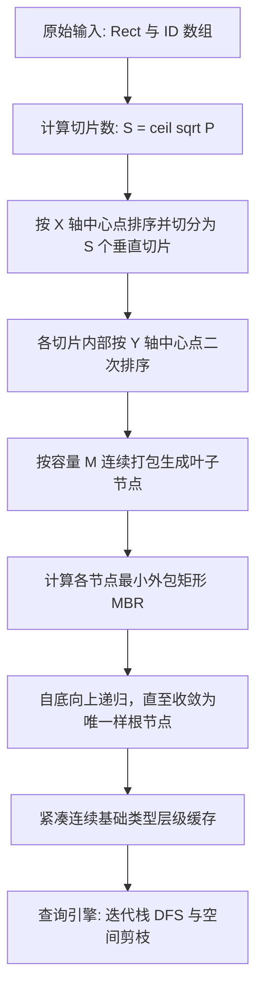

# MoonSTRtree 算法与架构设计规范

[English](./ARCHITECTURE.md) | [中文说明](./ARCHITECTURE_zh.md)

本文规范 MoonSTRtree 的 Sort-Tile-Recursive 批量构建流程、连续内存打包存储与查询剪枝引擎设计。接口签名与行为契约以 [接口文档](API_SPECIFICATION_zh.md) 为准。


## 架构总览

MoonSTRtree 实现一次性静态空间打包。所有空间图元被自底向上组织为紧凑的多层外包矩形，并以扁平数组形式存储。查询时通过迭代栈在连续数组上执行相交检测与子树剪枝，全程无额外堆分配。



## 模块分层与职责

| 领域模块 | 源码位置 | 核心职责 |
| :--- | :--- | :--- |
| 几何基元 (Geometry) | `src/geometry.mbt` | 2D 矩形 `Rect` 数据结构、坐标归一化、合法性校验、相交判定与点包含检测 |
| STR 构建器 (STR Builder) | `src/str.mbt` | 页数与切片规模计算、X/Y 轴双向中心点排序与切片、自底向上节点打包 |
| 紧凑树结构 (Packed Tree) | `src/tree.mbt` | 多层扁平连续数组布局、基于迭代栈的 DFS 查询遍历与子树剪枝 |
| 统计与诊断 (Diagnostics) | `src/stats.mbt` | 树高、节点数、空间填充率计算与结构完整性校验 |

## 1. Sort-Tile-Recursive (STR) 批量构建算法

给定空间对象数 $N$ 及节点容量 $M \ge 2$（默认 $M = 16$）：

1. **目标叶子页面数计算**：
   $$P = \left\lceil \frac{N}{M} \right\rceil$$
2. **垂直切片数计算**：
   $$S = \left\lceil \sqrt{P} \right\rceil$$
3. **切片容量**：
   每个垂直切片大约容纳 $S \times M$ 个空间矩形。
4. **X 轴切片划分**：
   按矩形几何中心 X 坐标排序：
   $$\text{center}_x = \frac{\min_x + \max_x}{2.0}$$
   将全部矩形连续划分为 $S$ 个垂直切片。
5. **Y 轴切片分组**：
   在每个垂直切片内部，按几何中心 Y 坐标排序：
   $$\text{center}_y = \frac{\min_y + \max_y}{2.0}$$
   每连续 $M$ 个矩形打包聚合为一个父节点。
6. **MBR 聚合**：
   父节点的最小外包矩形（MBR）为其所有子包围矩形的几何并集。
7. **自底向上递归**：
   将生成的父节点作为新输入，重复第 1–6 步，直到最终仅收敛为一个根节点。

## 2. 连续内存与扁平数组存储

为消除散列指针解引用开销、改善 CPU 缓存局部性并杜绝 WebAssembly / Native 运行时的 GC 抖动，整棵树的多层节点打平为连续基础类型数组：

```text
Level 2 (根节点):   [ 根节点 MBR ] -> 对应 Level 1 的子节点偏移区间
Level 1 (内部节点): [ 内部节点 MBR 0 | 内部节点 MBR 1 | ... ]
Level 0 (叶子节点): [ 叶子 MBR 0 (含 ID) | 叶子 MBR 1 (含 ID) | ... ]
```

每一层均由扁平连续数组支持：
- `boxes_min_x: Array[Double]`
- `boxes_min_y: Array[Double]`
- `boxes_max_x: Array[Double]`
- `boxes_max_y: Array[Double]`
- `child_indices: Array[Int]`
- `item_ids: Array[Int]`（仅叶子层）

## 3. 查询剪枝引擎

### 3.1 相交与包含判定谓词

两个轴对齐包围盒 $A$ 与 $B$ 相交充要条件：
$$\neg (A.\max_x < B.\min_x \lor A.\min_x > B.\max_x \lor A.\max_y < B.\min_y \lor A.\min_y > B.\max_y)$$

点 $(x, y)$ 位于包围盒 $B$ 内的判定条件：
$$B.\min_x \le x \le B.\max_x \land B.\min_y \le y \le B.\max_y$$

### 3.2 迭代栈遍历

查询过程采用迭代式深度优先遍历（Iterative Stack DFS），使用预分配容量的整数索引栈，彻底规避语言层函数调用栈溢出风险。遇到与查询窗口不相交的节点 MBR 时立刻跳过整棵子树，大幅提升剪枝效率。
