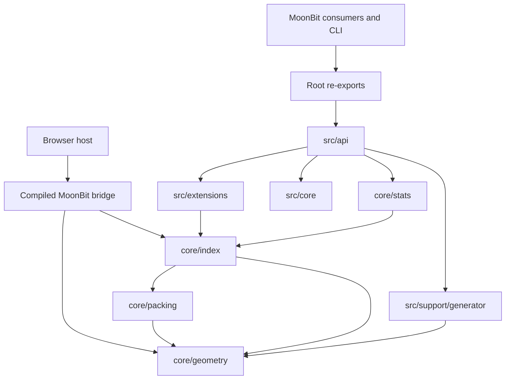

# Architecture

[English](ARCHITECTURE.md) | [中文](../zh/ARCHITECTURE.md)

## Dependency boundaries

The browser bridge imports core geometry and indexing directly and exposes a narrow JS host boundary. React owns controls and display; a worker owns construction, queries and comparison measurements. The former independent JavaScript STR implementation has been removed.

The rectangle bounds audit walks the actual MoonBit tree outside the timed query, descending only retained internal bounds. The canvas distinguishes retained and rejected bounds at the selected depth. This separate audit is not query traversal telemetry; other geometry modes display topology only.

| Layer | Ownership | Allowed dependencies |
| --- | --- | --- |
| Root | Re-exported public names | `src/api` |
| API | Canonical geometry re-exports and opaque index adapters | Core, extensions, generator |
| Core geometry | Pure coordinate operations and bounding-box predicates | Runtime primitives |
| Core packing | Integer page arithmetic, STR partition selection and sorting | Geometry |
| Core index | Packed buffers, iterative queries, nearest-neighbor, joins, center analytics | Geometry, packing |
| Core stats | 2D structural diagnostics | Geometry, index |
| Extensions | Geofence state, polygons, trajectory algorithms | Geometry, index |
| Support | Seeded datasets | Geometry |

MoonBit methods belong to the package defining their receiver type. Storage and query files therefore share `core/index`; directory layering does not move methods into an unrelated package. Individual files own storage, range traversal, nearest-neighbor, joins, buffers and statistics. Extension types own their methods in separate packages.

## Packing and storage

2D construction caches centers and partitions only at STR slice/page boundaries, avoiding a total ordering inside each page. It computes storage sizes before filling SoA columns, without a temporary object hierarchy. A final depth-first leaf arrangement gives every subtree a contiguous leaf interval. 3D still sorts X/Y/Z slices and 4D extends slicing to time; their direct-construction optimization is future work. The 4D temporary nodes retain explicit storage indices and levels, so equal bounds or IDs never determine child identity; standard O(n log n) sorts replace quadratic loops. Mutable views avoid slice copies in the legacy packing utilities. Integer page arithmetic avoids positive Int overflow.

Bounds use separate coordinate arrays. `child_offset` and `child_count` address adjacency ranges in `child_indices`; `item_ids` identify leaves. This is a structure-of-arrays layout with CSR-style adjacency. It does not guarantee zero allocations during construction or querying.

Coordinate payload estimates are 44 bytes per 2D node, 64 per 3D node and 80 per 4D node, plus 4 bytes per edge. Estimates exclude array headers, runtime object overhead, results and scratch space; JavaScript runtime representation can differ. Fill factor is occupied branch slots divided by branch count times node capacity; an index with no branches reports 1.

## Query ownership

Range and point queries use an iterative DFS and inclusive bounds. Nearest-neighbor APIs share one branch-and-bound traversal per dimension. A minimum heap orders pending nodes; a bounded maximum heap retains at most k candidates with the worst distance at its root. Candidate insertion/replacement costs O(log k), followed by one in-place O(k log k) sort of the returned pairs. Filtered search applies predicates before accepting a candidate. Distance-returning APIs expose squared distance, in ascending order; equal-distance IDs have no promised tie order.

Packed 2D queries copy wholly contained leaf intervals and keep partial leaf loops separate. A private derived layout hint is validated when restoring buffers; index storage and adapter internals are private. JavaScript specializes only integer result append/copy operations, while traversal stays in MoonBit. Other backends use ordinary MoonBit arrays. `query` owns its result and scratch arrays. `query_into` clears and reuses two distinct caller-owned arrays. Callers must not alias them or share them across concurrent operations. Counts avoid result arrays, but still own scratch storage. Query cost is distribution-sensitive and at least proportional to output size; worst-case overlap approaches O(N).

## Analytics and extensions

DBSCAN clusters bounding-box centers. Its shared expansion marks queued points so each entry is queued at most once. A temporary center index uses dense internal positions, preserving duplicate user IDs. `dbscan_compact` returns parallel `item_ids` and `labels` arrays in storage order with O(N) result storage. Legacy `dbscan` addresses labels by user ID and can require O(max_id) storage.

Trajectory windows and polygon windows return bounding-box candidates. They do not imply exact segment/time or polygon intersection without additional geometry checks. Topological predicates operate on bounding boxes, not arbitrary GIS geometries.

## Restoration and compatibility

Export/import copy arrays for independent ownership. `from_flat_buffers` remains a trusted copying restore; 2D also checks topology to rebuild its optional layout hint, without promising validation of all bounds. `from_flat_buffers_checked` validates dimensions, offsets, root connectivity, acyclicity, leaf count, height, finite coordinates and parent enclosures before restoration. A malformed buffer yields `None`.

All former root API declarations remain exposed through re-exports. Canonical geometry types belong to `src/core/geometry`; opaque consumer index adapters belong to `src/api`. Private adapter/storage fields replace direct mutation, and internal package paths changed; the generated interfaces intentionally reflect that migration. Internal package imports are not a stable consumer contract.

## Multidimensional browser functionality

A separate worker builds real 3D/4D MoonBit indexes. XY and XZ projections show the same synthetic bounds; 3D height ranges and 4D time slices change complete hit sets. An independent scan checks every ID. Exports retain full bounds and IDs; the on-page table previews only ten rows. This functional demonstration does not claim multidimensional performance results.
