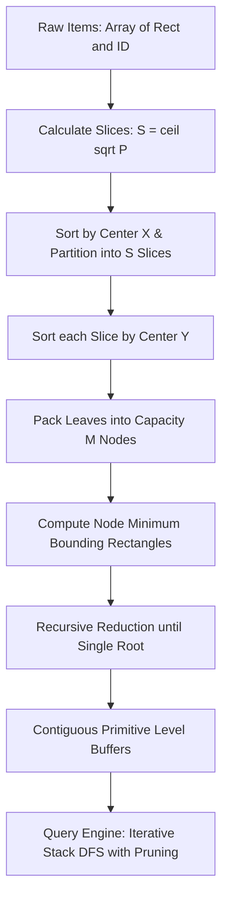

# MoonSTRtree Architecture and Algorithm Specification

[English](./ARCHITECTURE.md) | [中文说明](../zh/ARCHITECTURE.md)

This document specifies the Sort-Tile-Recursive bulk-loading pipeline, contiguous packed array storage, and query pruning engine for MoonSTRtree. Technical contracts follow [API Specification](API_SPECIFICATION.md).


## Architectural Overview

MoonSTRtree implements static, one-shot spatial packing. Items are partitioned into hierarchical bounding boxes stored in contiguous level arrays. Queries evaluate bounding box overlap using an iterative stack without heap allocations.



## Module Layering

| Module | Location | Responsibilities |
| :--- | :--- | :--- |
| Geometry | `src/geometry.mbt` | 2D bounding box `Rect`, coordinate normalization, validation, intersection, and point containment |
| STR Builder | `src/str.mbt` | Page/slice calculations, X/Y coordinate sorting, bottom-up node aggregation |
| Packed Tree | `src/tree.mbt` | Level buffer layout, iterative stack-based DFS traversal, range and point query evaluation |
| Diagnostics | `src/stats.mbt` | Tree height, node count, fill factor calculations, and structural validation |

## 1. Sort-Tile-Recursive (STR) Bulk-Loading

Given $N$ spatial objects and node capacity $M \ge 2$ (default $M = 16$):

1. **Leaf Page Count**:
   $$P = \left\lceil \frac{N}{M} \right\rceil$$
2. **Vertical Slice Count**:
   $$S = \left\lceil \sqrt{P} \right\rceil$$
3. **Slice Capacity**:
   Each vertical slice contains approximately $S \times M$ items.
4. **X-Partitioning**:
   Items are sorted along the X-axis by geometric center:
   $$\text{center}_x = \frac{\min_x + \max_x}{2.0}$$
   The dataset is partitioned into $S$ contiguous vertical slices.
5. **Y-Partitioning**:
   Within each slice, items are sorted along the Y-axis by geometric center:
   $$\text{center}_y = \frac{\min_y + \max_y}{2.0}$$
   Consecutive groups of $M$ items form a parent node.
6. **MBR Aggregation**:
   The Minimum Bounding Rectangle (MBR) is computed as the geometric union of all children.
7. **Bottom-Up Reduction**:
   Steps 1–6 are repeated with the parent nodes as inputs until a single root node remains.

## 2. Contiguous Level Storage

To eliminate pointer dereferencing and memory fragmentation on WebAssembly and Native runtimes, the hierarchy is stored in flat arrays:

```text
Level 2 (Root):   [ Root MBR ] -> child offset range in Level 1
Level 1 (Branch): [ Branch MBR 0 | Branch MBR 1 | ... ]
Level 0 (Leaves): [ Leaf MBR 0 (ID) | Leaf MBR 1 (ID) | ... ]
```

Each level is backed by primitive contiguous arrays:
- `boxes_min_x: Array[Double]`
- `boxes_min_y: Array[Double]`
- `boxes_max_x: Array[Double]`
- `boxes_max_y: Array[Double]`
- `child_indices: Array[Int]`
- `item_ids: Array[Int]` (leaf level only)

## 3. Query Pruning Engine

### 3.1 Intersection and Containment Predicates

Two axis-aligned bounding boxes $A$ and $B$ intersect if and only if:
$$\neg (A.\max_x < B.\min_x \lor A.\min_x > B.\max_x \lor A.\max_y < B.\min_y \lor A.\min_y > B.\max_y)$$

A point $(x, y)$ is contained in box $B$ if and only if:
$$B.\min_x \le x \le B.\max_x \land B.\min_y \le y \le B.\max_y$$

### 3.2 Iterative Traversal

Queries execute using an iterative Depth-First Search (DFS) stack of integer indices. Disjoint subtrees are skipped immediately without function call overhead. The stack capacity is bounded by the tree height multiplied by the node capacity $M$, eliminating call stack overflow risks.

## 4. 3D Spatial Architecture & Extensions (`StrTree3D`)

### 4.1 3D Three-Way Recursive Slicing
3D STR generalizes 2D Sort-Tile-Recursive bulk loading via cascaded cube root and square root partitioning:
1. Target leaf pages: $P = \lceil N / M \rceil$.
2. X-axis slabs: $S_x = \lceil P^{1/3} \rceil$. All items are sorted by centroid X coordinates and partitioned into $S_x$ vertical slabs.
3. Y-axis columns: For each slab with $P_x$ pages, calculate $S_y = \lceil \sqrt{P_x} \rceil$ columns. Items within the slab are sorted by centroid Y coordinates and sliced into columns.
4. Z-axis local sorting: Within each column, items are sorted by centroid Z coordinates and packed contiguously into leaf nodes of capacity $M$.
5. Bottom-up reduction: Generate parent 3D bounding boxes and recursively build levels until a single root is formed.

### 4.2 6-Tuple Native Array Layout and Zero-Copy Traversal
The entire 3D index is stored across 6 flat coordinate vectors (`boxes_min_x/y/z` and `boxes_max_x/y/z`) accompanied by Compressed Sparse Row (CSR) topology pointers (`child_offset`, `child_count`, `child_indices`) and item ID mappings, guaranteeing strict $O(N)$ cache-friendly memory compactness.

### 4.3 3D Branch-and-Bound k-NN & Ray Clipping
- **3D k-NN**: Branch-and-bound pruning using a flat binary min-heap keyed by squared Euclidean point-to-box distance. Nodes are pruned once the heap top exceeds the furthest candidate distance in a full $k$-element list.
- **3D Liang-Barsky Ray Clipping**: Axis-aligned parametric interval clipping $[t_{\min}, t_{\max}]$ prunes disjoint volumetric subtrees with microsecond-level throughput for line-of-sight and collision ray queries.

