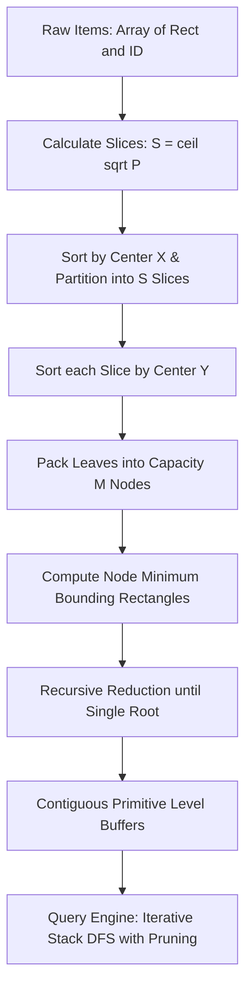

# MoonSTRtree Architecture and Algorithm Specification

[English](./ARCHITECTURE.md) | [中文说明](../zh/ARCHITECTURE.md)

This document specifies the Sort-Tile-Recursive bulk-loading pipeline, contiguous packed array storage, and query pruning engine for MoonSTRtree. Technical contracts follow [API Specification](API_SPECIFICATION.md).


## Architectural Overview

MoonSTRtree implements static, one-shot spatial packing. Items are partitioned into hierarchical bounding boxes stored in contiguous level arrays. Queries evaluate bounding box overlap using an iterative stack without heap allocations.



## Module Layering

| Module | Location | Responsibilities |
| :--- | :--- | :--- |
| Geometry | `src/geometry.mbt` | 2D bounding box `Rect`, coordinate normalization, validation, intersection, and point containment |
| STR Builder | `src/str.mbt` | Page/slice calculations, X/Y coordinate sorting, bottom-up node aggregation |
| Packed Tree | `src/tree.mbt` | Level buffer layout, iterative stack-based DFS traversal, range and point query evaluation |
| Diagnostics | `src/stats.mbt` | Tree height, node count, fill factor calculations, and structural validation |

## 1. Sort-Tile-Recursive (STR) Bulk-Loading

Given $N$ spatial objects and node capacity $M \ge 2$ (default $M = 16$):

1. **Leaf Page Count**:
   $$P = \left\lceil \frac{N}{M} \right\rceil$$
2. **Vertical Slice Count**:
   $$S = \left\lceil \sqrt{P} \right\rceil$$
3. **Slice Capacity**:
   Each vertical slice contains approximately $S \times M$ items.
4. **X-Partitioning**:
   Items are sorted along the X-axis by geometric center:
   $$\text{center}_x = \frac{\min_x + \max_x}{2.0}$$
   The dataset is partitioned into $S$ contiguous vertical slices.
5. **Y-Partitioning**:
   Within each slice, items are sorted along the Y-axis by geometric center:
   $$\text{center}_y = \frac{\min_y + \max_y}{2.0}$$
   Consecutive groups of $M$ items form a parent node.
6. **MBR Aggregation**:
   The Minimum Bounding Rectangle (MBR) is computed as the geometric union of all children.
7. **Bottom-Up Reduction**:
   Steps 1–6 are repeated with the parent nodes as inputs until a single root node remains.

## 2. Contiguous Level Storage

To eliminate pointer dereferencing and memory fragmentation on WebAssembly and Native runtimes, the hierarchy is stored in flat arrays:

```text
Level 2 (Root):   [ Root MBR ] -> child offset range in Level 1
Level 1 (Branch): [ Branch MBR 0 | Branch MBR 1 | ... ]
Level 0 (Leaves): [ Leaf MBR 0 (ID) | Leaf MBR 1 (ID) | ... ]
```

Each level is backed by primitive contiguous arrays:
- `boxes_min_x: Array[Double]`
- `boxes_min_y: Array[Double]`
- `boxes_max_x: Array[Double]`
- `boxes_max_y: Array[Double]`
- `child_indices: Array[Int]`
- `item_ids: Array[Int]` (leaf level only)

## 3. Query Pruning Engine

### 3.1 Intersection and Containment Predicates

Two axis-aligned bounding boxes $A$ and $B$ intersect if and only if:
$$\neg (A.\max_x < B.\min_x \lor A.\min_x > B.\max_x \lor A.\max_y < B.\min_y \lor A.\min_y > B.\max_y)$$

A point $(x, y)$ is contained in box $B$ if and only if:
$$B.\min_x \le x \le B.\max_x \land B.\min_y \le y \le B.\max_y$$

### 3.2 Iterative Traversal

Queries execute using an iterative Depth-First Search (DFS) stack of integer indices. Disjoint subtrees are skipped immediately without function call overhead. The stack capacity is bounded by the tree height multiplied by the node capacity $M$, eliminating call stack overflow risks.

## 4. 3D Spatial Architecture & Extensions (`StrTree3D`)

### 4.1 3D Three-Way Recursive Slicing
3D STR generalizes 2D Sort-Tile-Recursive bulk loading via cascaded cube root and square root partitioning:
1. Target leaf pages: $P = \lceil N / M \rceil$.
2. X-axis slabs: $S_x = \lceil P^{1/3} \rceil$. All items are sorted by centroid X coordinates and partitioned into $S_x$ vertical slabs.
3. Y-axis columns: For each slab with $P_x$ pages, calculate $S_y = \lceil \sqrt{P_x} \rceil$ columns. Items within the slab are sorted by centroid Y coordinates and sliced into columns.
4. Z-axis local sorting: Within each column, items are sorted by centroid Z coordinates and packed contiguously into leaf nodes of capacity $M$.
5. Bottom-up reduction: Generate parent 3D bounding boxes and recursively build levels until a single root is formed.

### 4.2 6-Tuple Native Array Layout and Zero-Copy Traversal
The entire 3D index is stored across 6 flat coordinate vectors (`boxes_min_x/y/z` and `boxes_max_x/y/z`) accompanied by Compressed Sparse Row (CSR) topology pointers (`child_offset`, `child_count`, `child_indices`) and item ID mappings, guaranteeing strict $O(N)$ cache-friendly memory compactness.

### 4.3 3D Branch-and-Bound k-NN & Ray Clipping
- **3D k-NN**: Branch-and-bound pruning using a flat binary min-heap keyed by squared Euclidean point-to-box distance. Nodes are pruned once the heap top exceeds the furthest candidate distance in a full $k$-element list.
- **3D Liang-Barsky Ray Clipping**: Axis-aligned parametric interval clipping $[t_{\min}, t_{\max}]$ prunes disjoint volumetric subtrees with microsecond-level throughput for line-of-sight and collision ray queries.

### 4.4 3D Dual-Tree Spatial Join & Serialization
- **3D Spatial Join**: `spatial_join` maintains synchronous node stacks, descending into children only when two nodes intersect across all three dimensions ($X, Y, Z$), preventing full $O(N_1 \times N_2)$ Cartesian explosions.
- **FlatBuffers3D**: Captures all 6 flat coordinate vectors and CSR topology arrays, ensuring zero-overhead binary persistence and cross-runtime exchange.

## 5. 3D Triangular Mesh Spatial Indexing & Accelerated Ray Tracing (`StrMeshTree3D`)

### 5.1 Two-Stage Accelerated Traversal Pipeline
Evaluating ray-triangle intersection across all facets of a dense 3D mesh incurs a prohibitive $O(N)$ computational burden.
`StrMeshTree3D` resolves this through a two-stage hierarchical acceleration pipeline:
1. **Stage 1 (Logarithmic Coarse Spatial Pruning)**: The tight $AABB_3$ of every triangle is bulk-loaded into an underlying `StrTree3D`. Queries (box, line segment, or ray) discard the vast majority of disjoint subtrees at logarithmic depth, returning only a tiny set of candidate facet IDs.
2. **Stage 2 (High-Precision Möller–Trumbore Evaluation)**: Only surviving candidates undergo exact `Triangle3D::ray_intersection` tests using barycentric coordinates, returning exact distance $t$ and surface normals with microsecond-level throughput.

## 6. 4D Spatiotemporal Geometry & Trajectory Indexing Architecture (`StrTree4D`)

### 6.1 4-Way Recursive Slicing Algorithm
Generalizes STR bulk-loading into 4-dimensional continuous spacetime manifold $(x, y, z, t)$:
1. Target leaf pages: $P = \lceil N / M \rceil$.
2. X-axis slicing: $S_x = \lceil P^{1/4} \rceil$. Globally partition items into $S_x$ spatial slabs sorted by centroid X.
3. Y-axis slicing: $S_y = \lceil P_x^{1/3} \rceil$. Slabs are partitioned into $S_y$ vertical columns sorted by centroid Y.
4. Z-axis slicing: $S_z = \lceil \sqrt{P_{xy}} \rceil$. Columns are sliced into $S_z$ volumetric pillars sorted by centroid Z.
5. T-axis contiguous leaf packing: Within each pillar, items are sorted by timestamp T and packed contiguously into leaf hypervolumes of capacity $M$.
6. Bottom-up hypervolume reduction recursively converges to a single root node.

### 6.2 8-Tuple Native Array Layout and Instantaneous Time-Slice Queries
The entire 4D tree is organized across 8 flat coordinate vectors (`boxes_min_x/y/z/t` and `boxes_max_x/y/z/t`). Supports sub-microsecond retrieval of moving entities through instantaneous cross-sectional queries (`query_time_slice(t, box_3d)`).

## 7. DE-9IM Topological Model & Adaptive Dual-Tree Spatial Join Architecture

### 7.1 DE-9IM Topological Spatial Computation Pipeline
Rooted in point-set topology, the topological relationship between geometries $A$ and $B$ is uniquely characterized by the intersection dimension matrix across Interior ($I$), Boundary ($B$), and Exterior ($E$):
$$\mathbf{DE9IM}(A, B) = \begin{bmatrix} \dim(I(A) \cap I(B)) & \dim(I(A) \cap B(B)) & \dim(I(A) \cap E(B)) \\ \dim(B(A) \cap I(B)) & \dim(B(A) \cap B(B)) & \dim(B(A) \cap E(B)) \\ \dim(E(A) \cap I(B)) & \dim(E(A) \cap B(B)) & \dim(E(A) \cap E(B)) \end{bmatrix}$$
For continuous bounding boxes, the engine evaluates this 9-cell matrix in $O(1)$ floating-point arithmetic, natively evaluating standard OGC predicates (`Intersects`, `Contains`, `Within`, `Touches`, `Overlaps`, `Disjoint`, `Equals`, `Covers`, `CoveredBy`).

### 7.2 Adaptive Dual-Tree Spatial Join Pipeline (Dual-Tree Adaptive Spatial Join)
Synchronously traverses two packed R-tree hierarchies using iterative stack DFS:
1. **Hierarchical Volume Pruning**: When bounding boxes of node $A$ and node $B$ do not intersect, their entire subtrees are pruned.
2. **Adaptive Area-Based Expansion**: When both nodes are internal, the node with larger bounding surface area is preferentially expanded, maximizing volumetric pruning.
3. **Leaf-Level Topological Filtering**: At the leaf level, candidate pairs are evaluated against the requested `SpatialPredicate`, emitting matching $(id_A, id_B)$ pairs with zero heap allocations during traversal.

---

## 8. Spatial Density Clustering & Grid Hotspot Architecture

### 8.1 Spatial Index-Accelerated DBSCAN
- **Algorithmic Complexity Optimization**: Traditional distance-matrix DBSCAN incurs $O(N^2)$ all-pairs distance overhead.
- **Index-Assisted Neighbor Pruning**: `StrTree::dbscan` and `StrTree3D::dbscan` delegate seed point neighbor expansions to circular/spherical range queries (`query_circle` and `query_sphere`), reducing neighbor search overhead per point to $O(\log N)$ and total clustering execution to $O(N \log N)$.
- **Flat Label State Machine**: Uses contiguous 1D integer arrays to maintain point visit status (unvisited, noise, cluster ID), eliminating heap fragmentation and pointer indirections.

### 8.2 Orthogonal Uniform Grid Density & Hotspot Ranking
- **Adaptive Extent Discretization**: Partitions the indexed universe into a regular 2D grid specified by row and column dimensions $(R, C)$.
- **Direct Cell Hashing**: Computes normalized row and column indices for geometry centroids $(x_c, y_c)$ in $O(1)$ time.
- **Hotspot Extraction**: Sorts non-empty cells in descending order of item counts and compiles global summary metrics (`GridDensitySummary`).

---

## 9. Geofencing State Machine & Trajectory Sliding Window Architecture

### 9.1 Streaming Geofence State Machine Architecture
- **Index-Backed Fence Queries**: Employs packed `StrTree` to manage static geofence bounding geometries in contiguous memory.
- **Discrete Transition Evaluation**: Maintains active fence ID sets per moving entity across consecutive time steps, applying set difference operations to emit `Enter`, `Stay`, and `Exit` events with minimal runtime allocation.
- **Entity Lifecycle Management**: Supports incremental bounding box or point updates, as well as entity deregistration emitting final `Exit` events.

### 9.2 Spatiotemporal Trajectory Segment & Sliding Window Architecture
- **Trajectory Segmentation**: Converts discrete GPS coordinates into directed spatiotemporal segments, calculating minimal 2D bounding boxes indexed via Sort-Tile-Recursive packing.
- **Two-Stage Spatiotemporal Pruning**:
  1. Spatial stage: Queries R-tree with target spatial window, pruning non-overlapping segments hierarchically in $O(\log N)$ time.
  2. Temporal stage: Filters surviving segment candidates against temporal interval $[seg.min\_t, seg.max\_t] \cap [t_{\min}, t_{\max}] \ne \emptyset$.
- **Track Identification & Kinematic Interpolation**: Aggregates unique track IDs traversing the window and computes linear spatial interpolation and velocity in $O(1)$ time.

---

## 10. Trajectory Simplification & Online Streaming Compression Architecture

### 10.1 2D Geometric & SED Spatiotemporal Simplification Pipeline
- **Recursive Divide-and-Conquer Extremum Discovery**: On monotonic waypoint sequences $[P_0, \dots, P_n]$, performs $O(N)$ chord distance evaluation to determine the point of maximum displacement.
- **Perpendicular Distance vs. Synchronized Euclidean Distance (SED)**:
  - Geometric Mode: Calculates 2D perpendicular distance from point to segment chord, eliminating collinear spatial points.
  - Spatiotemporal SED Mode: Derives the time-synchronized position on segment chord in $O(1)$ time and evaluates spatial displacement, preserving both geometric shape and temporal velocity variations.
- **Zero-Allocation Boolean Masking**: Avoids array partitioning and slice allocations by maintaining an in-place boolean bitmask `keep : Array[Bool]` tracking retained waypoints.

### 10.2 Online Sliding Error-Bounded Compressor Architecture
- **Incremental Buffer Evaluation**: `StreamingTrajectoryCompressor` operates continuously without loading entire trajectories, tracking current anchor points and uncommitted buffers.
- **Immediate Waypoint Emission**: Commits preceding inflection waypoints to downstream consumers as soon as a newly arrived waypoint causes the buffer error to exceed tolerance $\epsilon$, providing deterministic constant-bounded memory and low latency.

---

## 11. Trajectory Dynamic Time Warping & Discrete Fréchet Architecture

### 11.1 Sakoe-Chiba Band Constraint & Dual-Row Rolling Buffer Architecture
- **Locality & Band Pruning**: Evaluates the cumulative cost recurrence $D(i, j)$ under a Sakoe-Chiba warping window $|i - j| \le w$, constraining DP state transitions to the diagonal band. Out-of-band states evaluate to $\infty$ without allocation, preventing extreme temporal dilation and skipping unnecessary pairwise distance computations.
- **$O(M)$ Dual-Row Rolling Memory Allocation**: Since cell $D(i, j)$ depends solely on $(i-1, j)$, $(i, j-1)$, and $(i-1, j-1)$, the algorithm allocates two contiguous 1D arrays (`prev` and `curr`) of length $M+1$. Row states are swapped after each iteration, reducing memory requirements from $O(N \cdot M)$ to $O(M)$.

### 11.2 Discrete Fréchet Bottleneck Metric Architecture
- **Minimax Bottleneck Recurrence**: Evaluates discrete Fréchet distance via $\max(d(p_i, q_j), \min(\dots))$, capturing the maximum Euclidean separation between coupled waypoints. Executes over an $O(M)$ rolling buffer to guarantee deterministic memory usage.

---

## 12. Polygon Geometry & Sutherland-Hodgman Viewport Clipping Architecture

### 12.1 Ring Vertex Normalization & Shoelace Area Pipeline
- **Ring Normalization**: Automatically identifies and deduplicates trailing closure vertices, yielding a canonical open ring vertex list and avoiding division-by-zero artifacts.
- **Shoelace Metric & Area-Weighted Centroids**: Computes polygon planar area in $O(N)$ time via Green's divergence theorem and evaluates exact polygonal centroids via weighted moment aggregation over non-degenerate meshes.

### 12.2 Sutherland-Hodgman Cascading Half-Plane Pipeline
- **Four-Stage Half-Plane State Machine**: Decomposes axis-aligned rectangular clipping into 4 independent linear half-plane filtering stages (Left, Right, Bottom, Top). Each stage tests consecutive vertex pairs $(P_1, P_2)$ against the half-space boundary, outputting intersection coordinates and inside vertices.
- **Tile-Level Polygon Index Accelerated Pruning**: `StrPolygonIndex` uses the packed STR tree to prune candidate polygons against the viewport in logarithmic time. Sutherland-Hodgman clipping is executed exclusively on candidates whose bounding envelopes intersect the query box, filtering degenerate slivers (area $< 10^{-12}$ or $< 3$ vertices) before returning clipped vector tile features.


