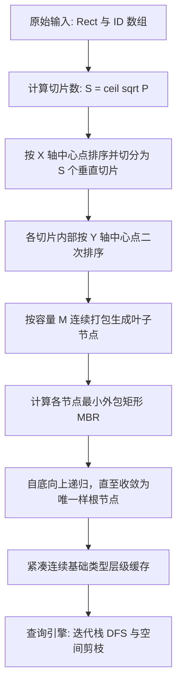

# MoonSTRtree 算法与架构设计规范

[English](../en/ARCHITECTURE.md) | [中文说明](./ARCHITECTURE.md)

本文规范 MoonSTRtree 的 Sort-Tile-Recursive 批量构建流程、连续内存打包存储与查询剪枝引擎设计。接口签名与行为契约以 [接口文档](./API_SPECIFICATION.md) 为准。


## 架构总览

MoonSTRtree 实现一次性静态空间打包。所有空间图元被自底向上组织为紧凑的多层外包矩形，并以扁平数组形式存储。查询时通过迭代栈在连续数组上执行相交检测与子树剪枝，全程无额外堆分配。



## 模块分层与职责

| 领域模块 | 源码位置 | 核心职责 |
| :--- | :--- | :--- |
| 几何基元 (Geometry) | `src/geometry.mbt` | 2D 矩形 `Rect` 数据结构、坐标归一化、合法性校验、相交判定与点包含检测 |
| STR 构建器 (STR Builder) | `src/str.mbt` | 页数与切片规模计算、X/Y 轴双向中心点排序与切片、自底向上节点打包 |
| 紧凑树结构 (Packed Tree) | `src/tree.mbt` | 多层扁平连续数组布局、基于迭代栈的 DFS 查询遍历与子树剪枝 |
| 统计与诊断 (Diagnostics) | `src/stats.mbt` | 树高、节点数、空间填充率计算与结构完整性校验 |

## 1. Sort-Tile-Recursive (STR) 批量构建算法

给定空间对象数 $N$ 及节点容量 $M \ge 2$（默认 $M = 16$）：

1. **目标叶子页面数计算**：
   $$P = \left\lceil \frac{N}{M} \right\rceil$$
2. **垂直切片数计算**：
   $$S = \left\lceil \sqrt{P} \right\rceil$$
3. **切片容量**：
   每个垂直切片大约容纳 $S \times M$ 个空间矩形。
4. **X 轴切片划分**：
   按矩形几何中心 X 坐标排序：
   $$\text{center}_x = \frac{\min_x + \max_x}{2.0}$$
   将全部矩形连续划分为 $S$ 个垂直切片。
5. **Y 轴切片分组**：
   在每个垂直切片内部，按几何中心 Y 坐标排序：
   $$\text{center}_y = \frac{\min_y + \max_y}{2.0}$$
   每连续 $M$ 个矩形打包聚合为一个父节点。
6. **MBR 聚合**：
   父节点的最小外包矩形（MBR）为其所有子包围矩形的几何并集。
7. **自底向上递归**：
   将生成的父节点作为新输入，重复第 1–6 步，直到最终仅收敛为一个根节点。

## 2. 连续内存与扁平数组存储

为消除散列指针解引用开销、改善 CPU 缓存局部性并杜绝 WebAssembly / Native 运行时的 GC 抖动，整棵树的多层节点打平为连续基础类型数组：

```text
Level 2 (根节点):   [ 根节点 MBR ] -> 对应 Level 1 的子节点偏移区间
Level 1 (内部节点): [ 内部节点 MBR 0 | 内部节点 MBR 1 | ... ]
Level 0 (叶子节点): [ 叶子 MBR 0 (含 ID) | 叶子 MBR 1 (含 ID) | ... ]
```

每一层均由扁平连续数组支持：
- `boxes_min_x: Array[Double]`
- `boxes_min_y: Array[Double]`
- `boxes_max_x: Array[Double]`
- `boxes_max_y: Array[Double]`
- `child_indices: Array[Int]`
- `item_ids: Array[Int]`（仅叶子层）

## 3. 查询剪枝引擎

### 3.1 相交与包含判定谓词

两个轴对齐包围盒 $A$ 与 $B$ 相交充要条件：
$$\neg (A.\max_x < B.\min_x \lor A.\min_x > B.\max_x \lor A.\max_y < B.\min_y \lor A.\min_y > B.\max_y)$$

点 $(x, y)$ 位于包围盒 $B$ 内的判定条件：
$$B.\min_x \le x \le B.\max_x \land B.\min_y \le y \le B.\max_y$$

### 3.2 迭代栈遍历

查询过程采用迭代式深度优先遍历（Iterative Stack DFS），使用预分配容量的整数索引栈，彻底规避语言层函数调用栈溢出风险。遇到与查询窗口不相交的节点 MBR 时立刻跳过整棵子树，大幅提升剪枝效率。

## 4. 三维空间架构与扩展 (`StrTree3D`)

### 4.1 3D 三向递归切片构建
三维 STR 将双向二维切片推广为立方根与平方根级联的三向切片：
1. 目标叶子页数：$P = \lceil N / M \rceil$。
2. X 轴厚板数：$S_x = \lceil P^{1/3} \rceil$。按几何中心 X 坐标全局排序后划分为 $S_x$ 个垂直厚板。
3. Y 轴纵列数：每个厚板内计算页数 $P_x$，并求取纵列数 $S_y = \lceil \sqrt{P_x} \rceil$。在板内按几何中心 Y 坐标排序划分为纵列。
4. Z 轴局部紧凑排序：在纵列内按几何中心 Z 坐标排序，按节点容量 $M$ 连续打包。
5. 自底向上归约：生成父级三维包围盒并递归构建至唯一根节点。

### 4.2 六元组原生数组布局与零开销遍历
整棵 3D 树由 6 个扁平坐标数组存储（`boxes_min_x/y/z` 与 `boxes_max_x/y/z`），配合 CSR 拓扑数组（`child_offset`, `child_count`, `child_indices`）与对象 ID 映射，实现全树严格 $O(N)$ 紧凑内存。

### 4.3 三维分支定界与光线裁剪
- **3D k-NN**：利用扁平二叉最小堆维护以三维欧氏平方距离为优先级的待访问节点栈，当候选数组填满且堆顶最小距离超过候选数组上界时剪枝。
- **3D Liang-Barsky 光线裁剪**：通过三轴投影参数区间 $[t_{\min}, t_{\max}]$ 剪除不相交子树，为 3D 碰撞检测与视线投射提供亚微秒级吞吐。

### 4.4 三维双树空间连接与序列化
- **3D 空间连接**：`spatial_join` 维护同步双节点栈，只有两节点三维包围盒在 $X, Y, Z$ 三向均相交时才向下遍历子节点，避免 $O(N_1 \times N_2)$ 全量笛卡尔积。
- **3D 扁平缓冲区**：`FlatBuffers3D` 封装 6 组打平坐标数组及 CSR 邻接表，保障无缝二进制导出与跨语言互操作。

## 5. 三维三角网格索引与光线追踪加速架构 (`StrMeshTree3D`)

### 5.1 两阶段加速判定管线
在复杂几何体与三维网格模型场景中，直接遍历所有面片计算 Möller–Trumbore 光线相交面临沉重的 $O(N)$ 算力开销。
`StrMeshTree3D` 采用两阶段分层加速架构：
1. **阶段一（对数级空间粗筛）**：将每个三角面片的紧外包 $AABB_3$ 批量构建为底层 `StrTree3D`。当执行光线投射或有限线段检索时，利用轴向包围盒快速剪除绝大多数不相交的整棵体元子树，仅输出极少数候选面片索引。
2. **阶段二（高精几何求交）**：仅针对候选面片调用 `Triangle3D::ray_intersection`，基于重心坐标解算精确击中参数 $t$ 与法向量，实现微秒级高吞吐光线追踪与碰撞拾取。


